# Отчёт по лабораторной работе №2. Node-RED

**Студент:** Сенкель Ярослав Витальевич

## 1. Среда и версии

Docker на компьютере не установлен, поэтому Node-RED поставлен через npm в папке `lab2`. Это ачивка 8: локальный запуск без контейнера.

- Запуск: `npm install`, затем `npm start` (`node-red --userDir ./nodered-data`).
- Каталог данных: `lab2/nodered-data`. Он в `.gitignore`, потому что там лежат установленные пакеты и `flows_cred.json` с токеном бота.
- Редактор: http://localhost:1880 , панель: http://localhost:1880/ui .
- **Node.js:** v22.20.0
- **Node-RED:** 4.1.17
- **Пакеты:** `node-red-dashboard` 3.6.6, `node-red-contrib-telegrambot` 16.4.0.

Отличие от Docker: образ сам поднимает процесс и volume `/data`, а здесь Node-RED — обычная зависимость проекта. Папка `nodered-data` играет ту же роль, что volume: потоки, ноды и контекст остаются после перезапуска. Файл `docker-compose.yml` лежит рядом на случай машины, где Docker уже есть.

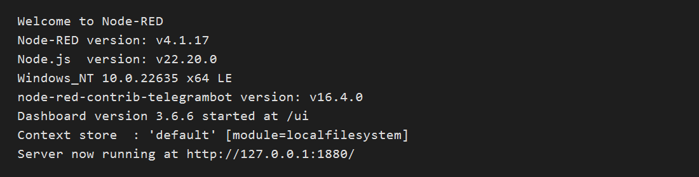

## 2. Что сделано

Двенадцать обязательных потоков и дополнительный CRUD. Каждый поток — отдельный файл в `lab2/flows/`. В `msg.topic`, payload и подписях стоит фамилия Сенкель.

1. **Базовые потоки**
   - `inject` → `debug`: каждые 5 секунд строка «Сенкель», `msg.topic = lab2/senkel/basic`, debug показывает complete msg object.
   - `function`: среднее оценок. В коде есть `let`/`const`, `if`/`else`, цикл `for`, массив и объект. Статус `отлично`, если среднее не меньше 8.
   - `switch`: та же логика, ветка по `msg.payload`. «отлично» уходит на первый debug, остальное — на второй.
   - `change`: выставляет `msg.topic`, `msg.timestamp` (текущее время) и новый `msg.payload`.
   - `template`: Mustache собирает JSON из объекта `{student, lab, topic}`.
2. **Сеть**
   - `http request`: GET `https://catfact.ninja/fact`, ответ — разобранный JSON.
   - MQTT: раз в 5 секунд случайная температура в топик `student/senkel/lab2/temperature` на `broker.hivemq.com:1883`, `mqtt in` читает тот же топик.
   - Свои GET: `/api/text`, `/api/info`, `/api/items/:id` с query `status`. Коды 200, 400 и 404. Описание — в [api.md](api.md).
3. **Интерфейс и бот**
   - Dashboard: вкладка «Сенкель Lab2», группа «Датчик Сенкель», gauge и chart. Inject раз в 2 секунды имитирует температуру.
   - Бот `tvl_lab2_senkel_bot`: `/start`, `/status` и эхо обычного текста. Токен из BotFather вводится в config-ноде и в репозиторий не кладётся. Пока токен не вставлен, ноды пишут `bot not initialized`.
4. **Файл и контекст**
   - Запись и чтение `lab2/files/senkel-lab2.txt`. Строка дописывается, файл остаётся после перезапуска Node-RED.
   - Flow context: счётчик `senkelCounter` увеличивается отдельным inject и читается другим. Значение живёт между сообщениями.
5. **Дополнительно, не отдельная ачивка.** Полный CRUD заметок: `GET/POST /api/notes`, `GET/PATCH/DELETE /api/notes/:id`. Хранение — flow context, потому что список должен переживать запросы, а код без файла проще показать на защите. Контекст пишется на диск (`contextStorage` в `settings.js`).

## 3. Использование ИИ

ИИ собирал код function-нод, Mustache-шаблон и каркас JSON потоков. Подключение нод, запуск через npm, установка пакетов и проверка запросов делались в редакторе.

Примеры промптов:

- «Function node для Node-RED: на входе массив оценок. Используй let/const, if/else, цикл for, массив и объект. Посчитай среднее и верни статус отлично, если среднее не меньше 8, иначе нужно подтянуть. В ответе поля student, scores, average, status.»
- «Mustache-шаблон: из payload.student, payload.lab и payload.topic собери JSON с полем text.»
- «GET /api/items/:id: id — положительное целое, query status только active или draft. Некорректный id или status — 400, нет элемента — 404.»
- «Telegram: /start и /status, на обычный текст эхо с префиксом фамилии, команды не повторять.»

## 4. Освоенные ноды

- Базовые: `inject`, `debug`, `function`, `switch`, `change`, `template`.
- Сеть: `http request`, `http in`, `http response`, `mqtt in`, `mqtt out`, `mqtt-broker`.
- Интерфейс: `ui_gauge`, `ui_chart`, `ui_group`, `ui_tab`, `telegram bot`, `telegram command`, `telegram receiver`, `telegram sender`.
- Данные: `file`, `file in`, `flow.get` / `flow.set`.

## 5. Скриншоты

| Задание | Скриншот |
| --- | --- |
| Версии |  |
| 2.1 Inject → Debug | 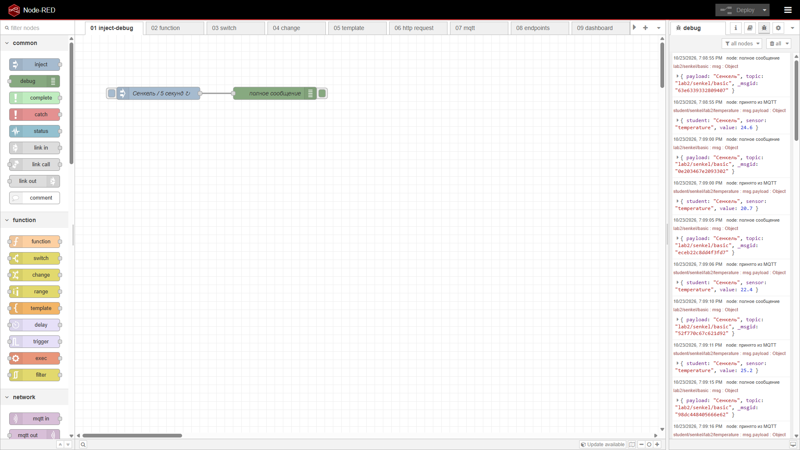 |
| 2.2 Function | 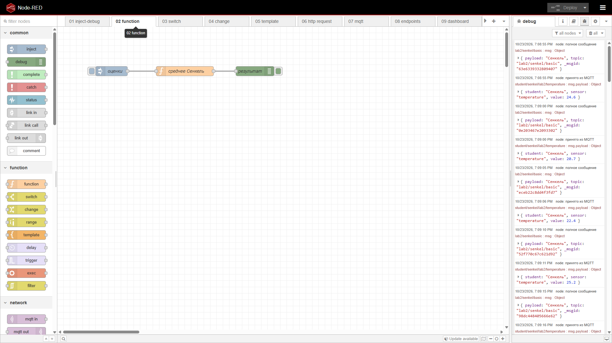 |
| 2.3 Switch | 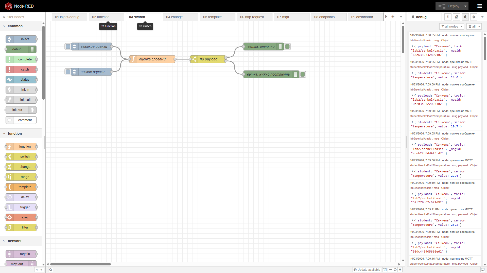 |
| 2.4 Change | 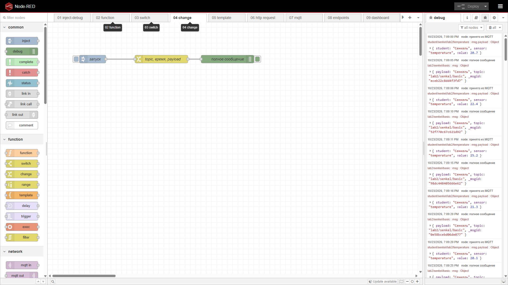 |
| 2.5 Template | 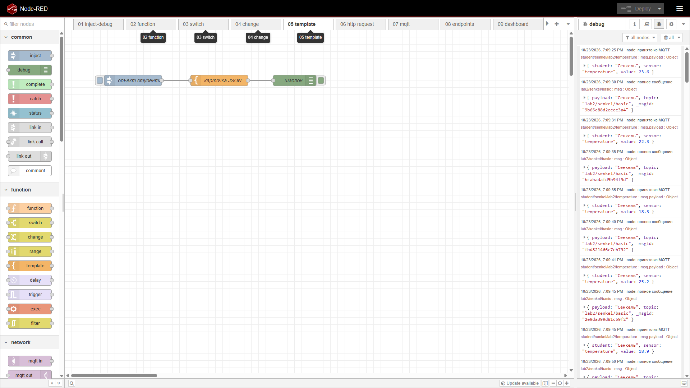 |
| 2.6 HTTP Request | 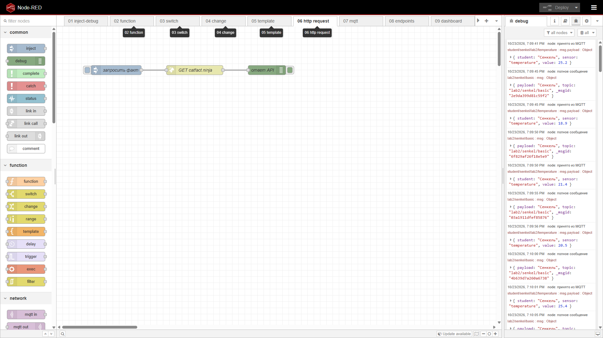 |
| 2.7 MQTT | 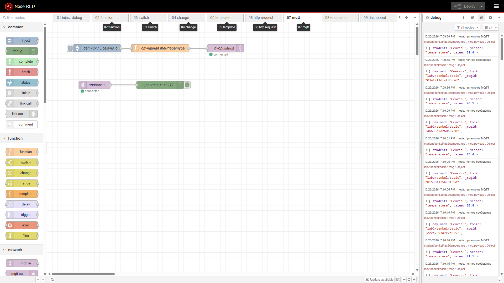 |
| 2.8 Схема эндпоинтов | 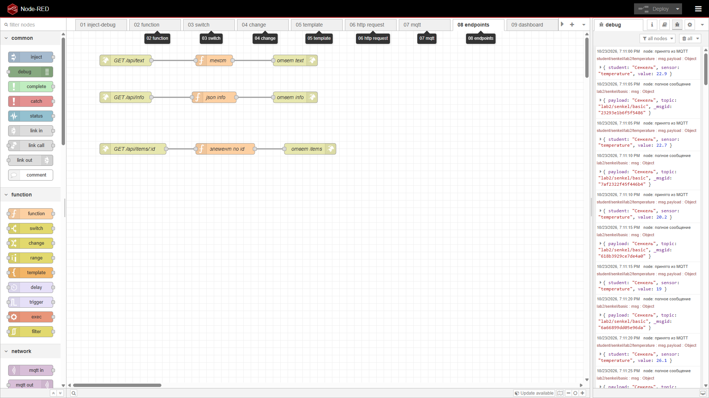 |
| 2.8 GET /api/text |  |
| 2.8 GET /api/info | 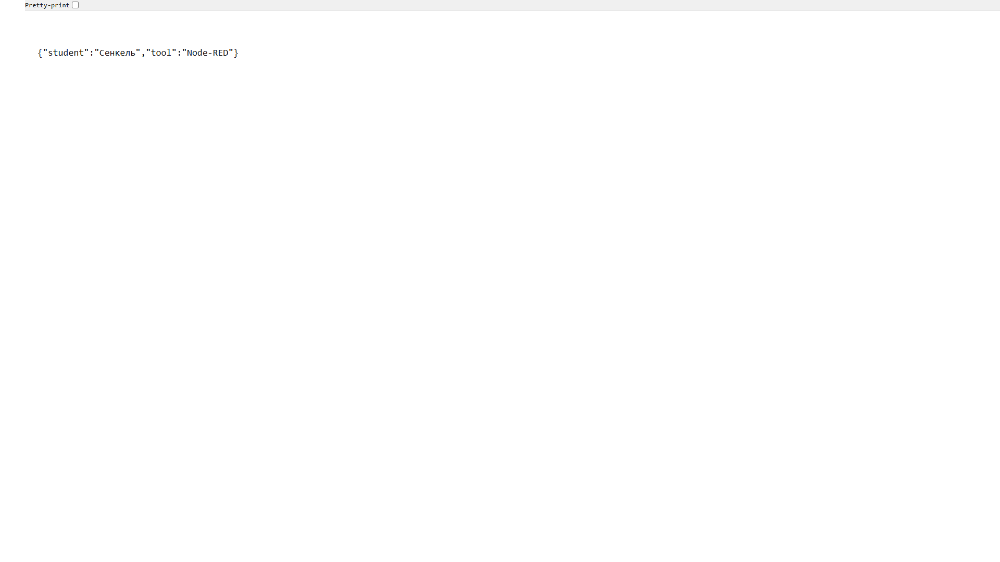 |
| 2.8 GET /api/items/1 | 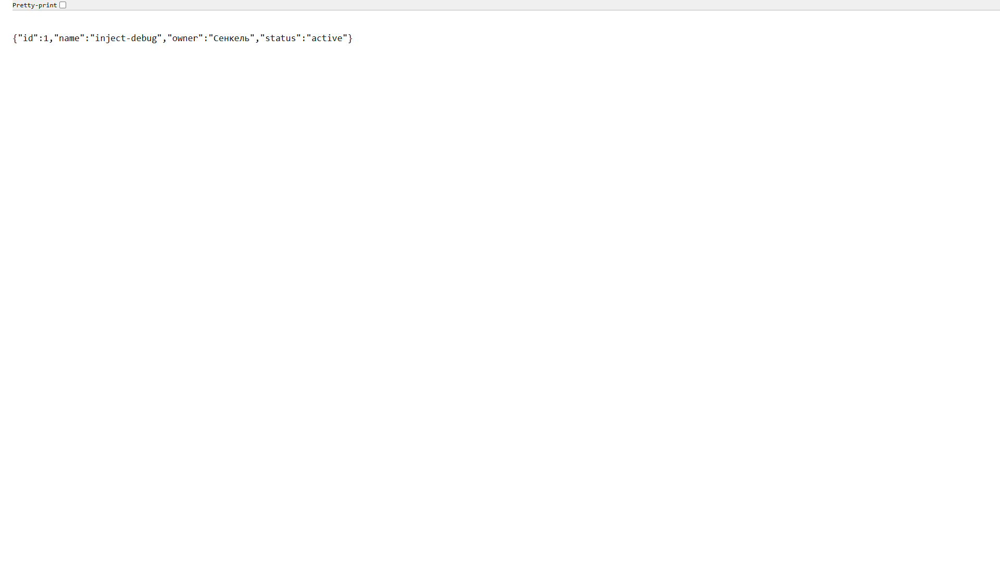 |
| 2.8 Ошибка 400 / 404 | 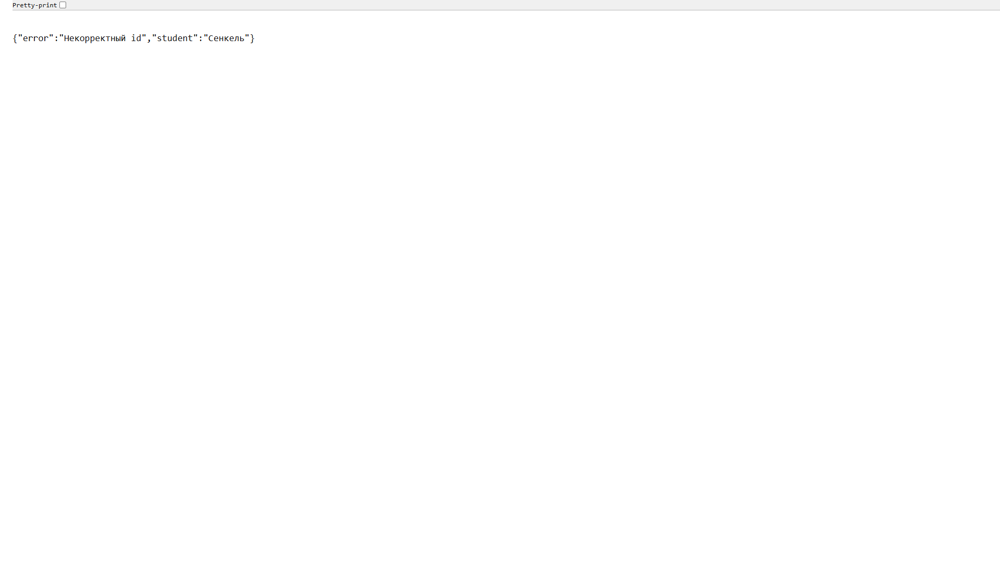 |
| 2.9 Dashboard | 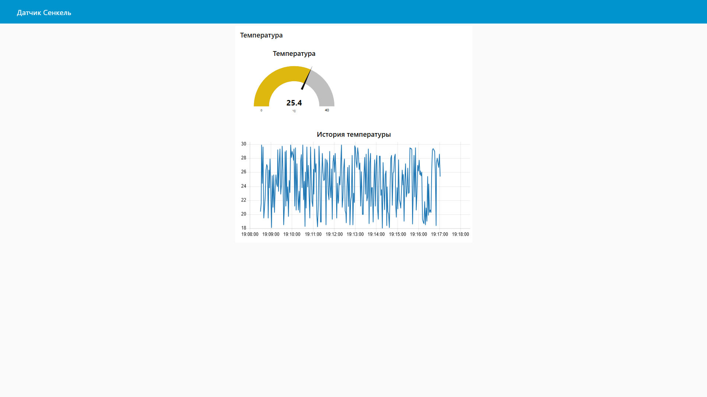 |
| 2.10 Telegram | 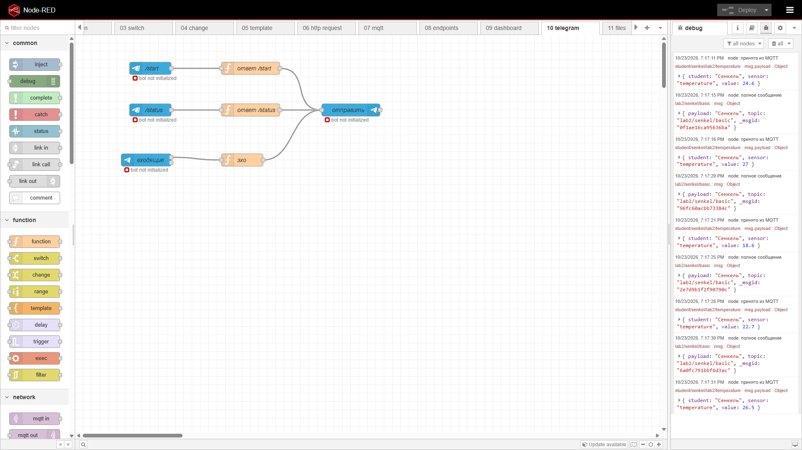 |
| 2.11 Файл | 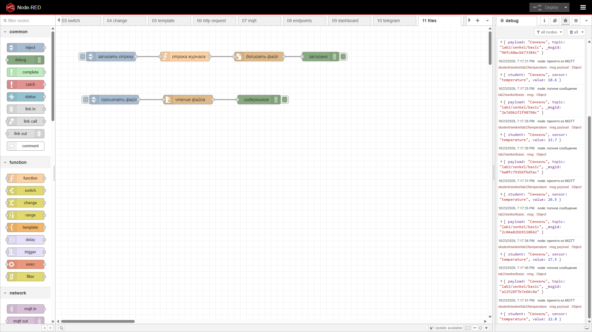 |
| 2.12 Flow context | 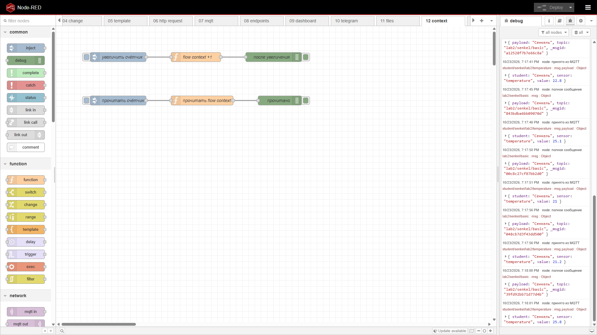 |

## 6. Вывод

В Node-RED большая часть лабораторной собирается из готовых нод: inject, switch, http и mqtt не требуют своего сервера. Код понадобился там, где нужна своя логика: среднее оценок, проверка id и список заметок. Сложнее всего оказалось понять, куда деваются данные. Без каталога `nodered-data` после перезапуска пропали бы и установленные ноды, и flow context. Файл журнала поэтому лежит отдельно в `lab2/files` и остаётся в репозитории.
