# Отчёт по лабораторной работе №3. Bubble

**Студент:** Сенкель Ярослав Витальевич

Приложение «Зелёный подоконник» собрано на бесплатном плане Bubble, в одном приложении `senkelyv24`. Это публичный каталог комнатных растений. Ачивку в этой работе не брал: ни API Connector, ни плагин.

Dev-версия каталога: https://senkelyv24.bubbleapps.io/version-test

Журнал полива: https://senkelyv24.bubbleapps.io/version-test/watering

## 1. Что сделано

На странице `index` есть шапка, форма добавления растения, поиск, список и подвал. Растение хранит название, вид, дату посадки и признак «нужен полив». В базе три растения: Алоэ, Монстера и Фикус.

Вручную, без агента, дописал имя в шапку, завёл цветовую переменную, стиль кнопки и готовый компонент Alert. Вторую сущность, журнал полива `WateringLog`, завёл сам. Страницу `watering` с формой и списком собрал агент, workflows проверил в Preview: запись создаётся, меняется и удаляется. Пробную запись после проверки удалил, в базе остались исходные три полива.

## 2. Промпт из части 1

```
Создай приложение на тему «Каталог растений» — «Зелёный подоконник». Пусть этот сайт будет публичный. Страницу обязательно создай по структуре header + body + footer. Обязательно укажи в заготовке следующую строку: «ТВП: Сенкель». Добавь несколько интерактивных элементов (CRUD): форму добавления растения (название, вид, дата посадки, нужен ли полив), список растений, кнопки редактирования и удаления.
```

Агент ответил, что собрал публичный каталог с CRUD на странице `index`.

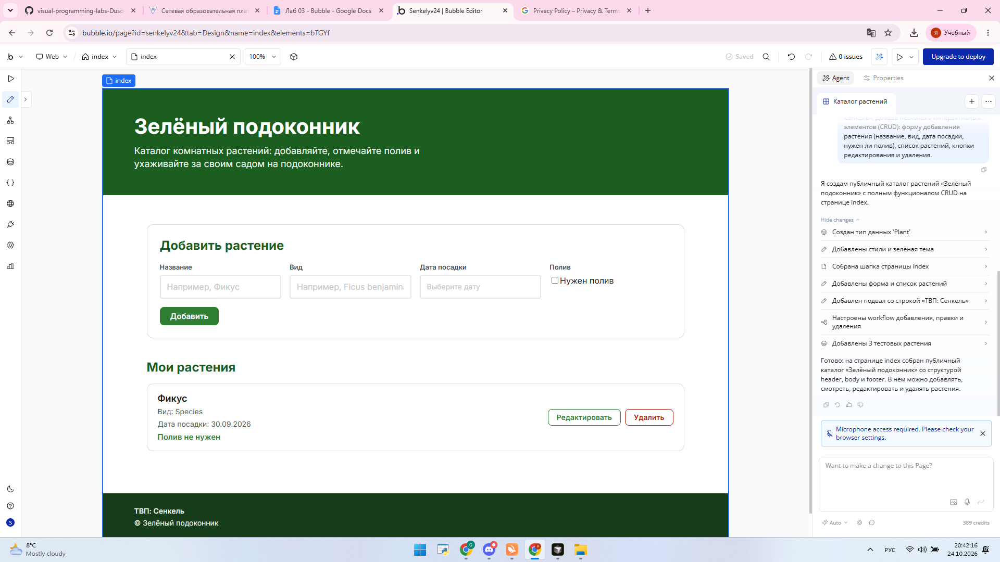

## 3. Build Guides

Смотрел гайды на https://bubble.io/home/buildguides : правку и удаление растения, поиск и фильтр. В своё приложение взял поле поиска над списком. Тип данных из гайда не переносил: тип `Plant` уже был.

Промпт агенту:

```
Над заголовком «Мои растения» добавь поле ввода с плейсхолдером «Поиск по названию». Поле должно стоять между формой «Добавить растение» и заголовком «Мои растения», на всю ширину списка. Список растений фильтруй сразу при вводе: ограничение «название contains значение поля поиска», пустое значение игнорируй. Форму, кнопки и подвал не меняй. Новые записи в базу не создавай.
```

В Preview полное название «Фикус» оставляет в списке только Фикус. Обрывок «Фик» не находит ничего: ограничение срабатывает как совпадение всего названия, а не как поиск по части строки.

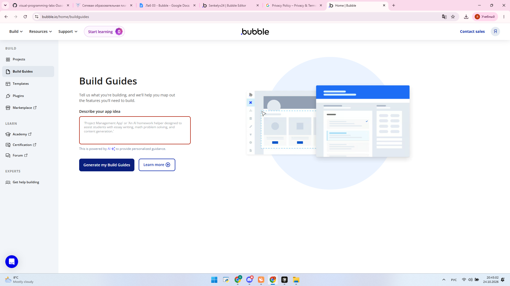


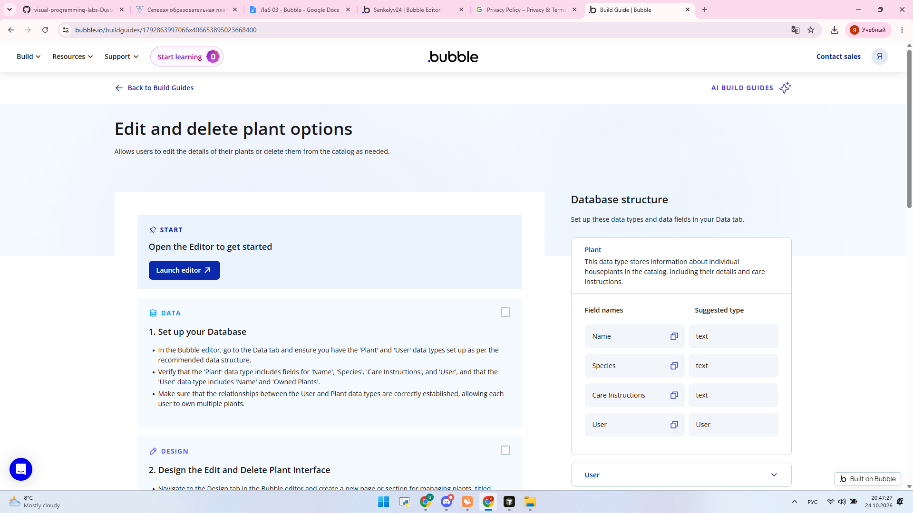

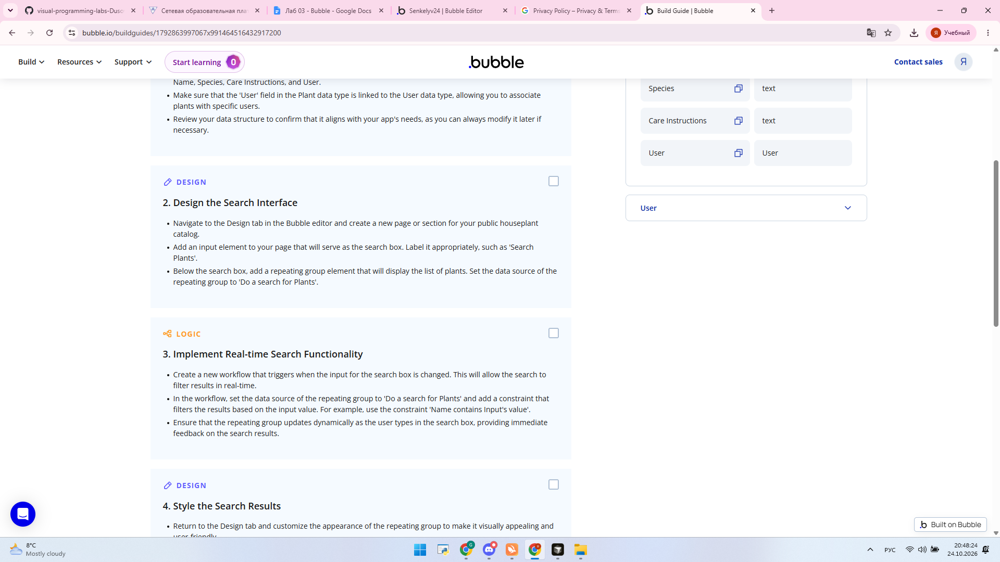

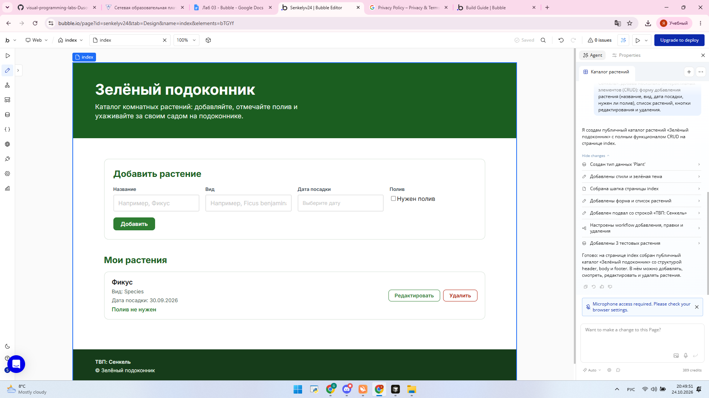

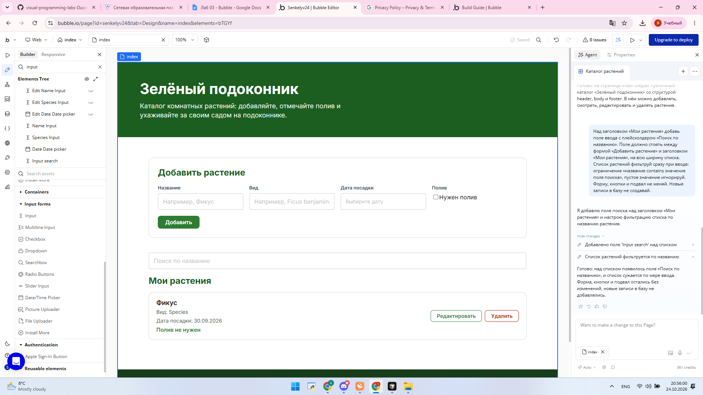

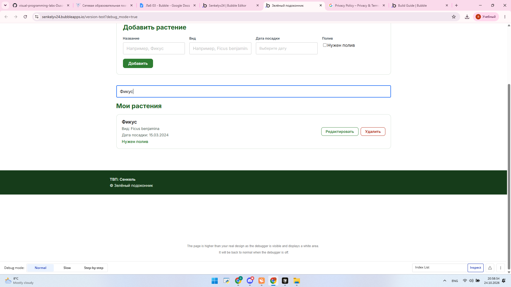

## 4. Ручная доработка

Шапка: «Зелёный подоконник — Ярослав». Подвал оставил со строкой из промпта, «ТВП: Ярослав Сенкель».

Цветовая переменная `primary-color`, значение `#1B5E20`. Ею залит фон кнопки «Добавить». Это отдельная переменная, не встроенный Primary.

Стиль «Кнопка растения» сделан от кнопки «Добавить» и на неё же повешен. Фон стиля берётся из `primary-color`.

Компонент Alert поставил в шапку. Текст: «Не забудьте отметить полив». Фон — `primary-color`, текст белый, иначе зелёная надпись на тёмно-зелёном фоне не читается.

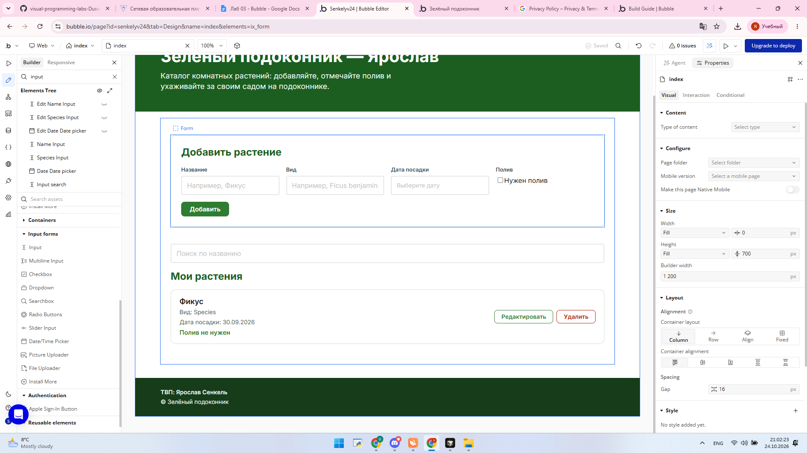

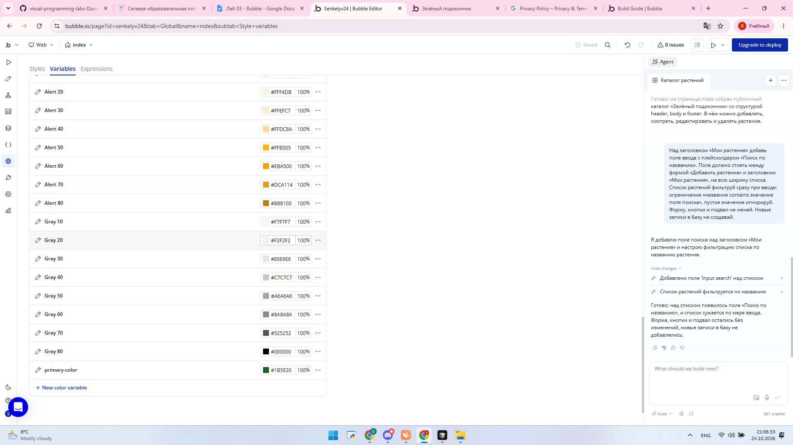

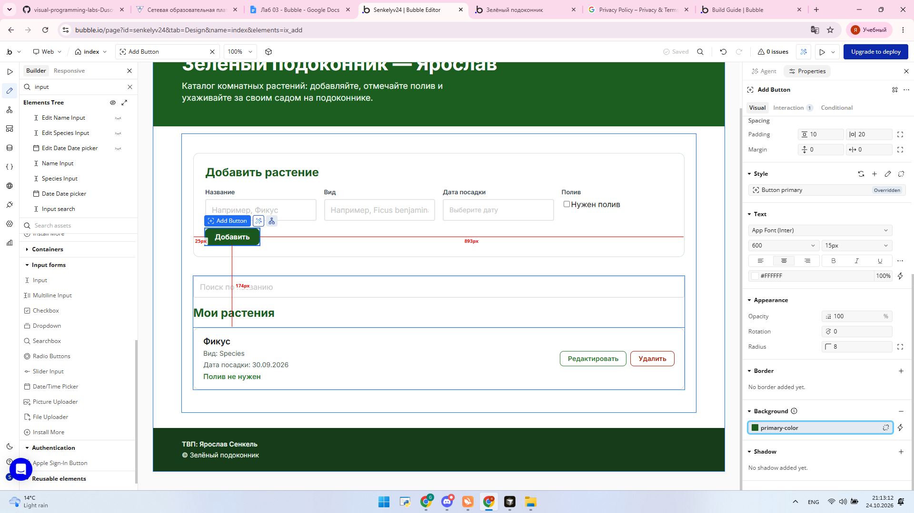

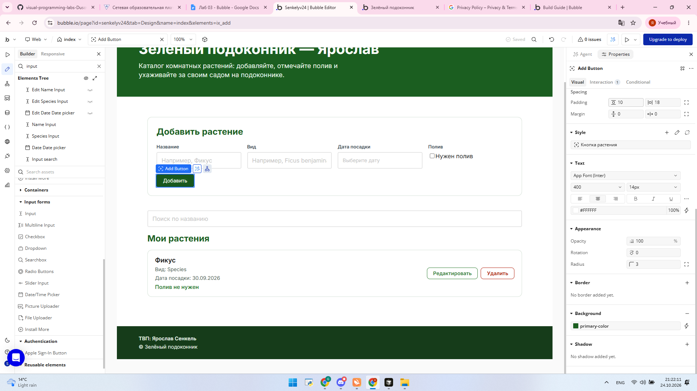

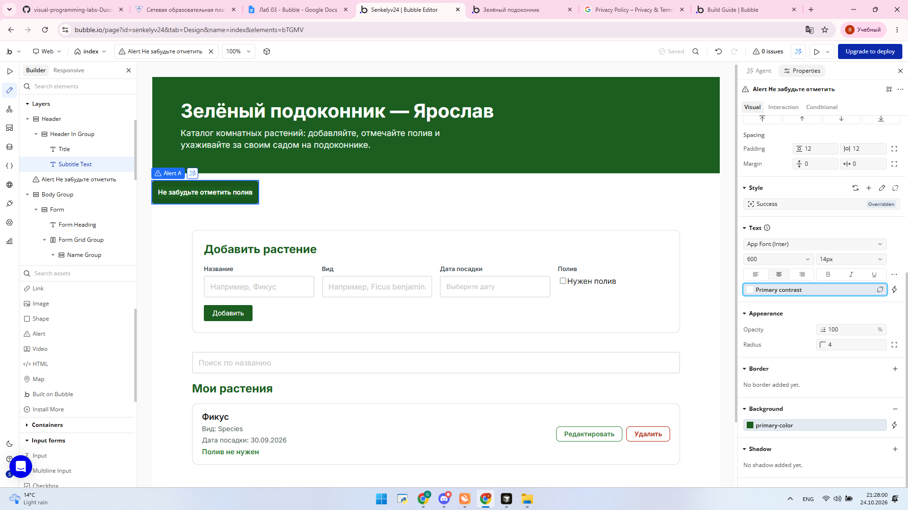

## 5. Данные

Промпт для второй сущности:

```
Придумай название и поля второй сущности для каталога «Зелёный подоконник». Это журнал полива, связанный с уже существующим типом Plant. Название типа: WateringLog. Поля разных типов: plant — ссылка на Plant (не список), watered_on — date, amount_ml — number, note — text. Тип оставь публичным. Новые записи и страницу пока не создавай.
```

Тип `WateringLog` создан вручную и оставлен публичным. Поля: `plant` (одна ссылка на `Plant`), `watered_on` (date), `amount_ml` (number), `note` (text). У `Plant` основное поле для показа — `name`.

Три записи внёс сам, растения не добавлял:

| Растение | Дата | мл | Заметка |
| --- | --- | --- | --- |
| Фикус | 20.10.2026 | 200 | Проверил почву |
| Монстера | 18.10.2026 | 350 | Опрыскал листья |
| Алоэ | 22.10.2026 | 50 | Мало воды |

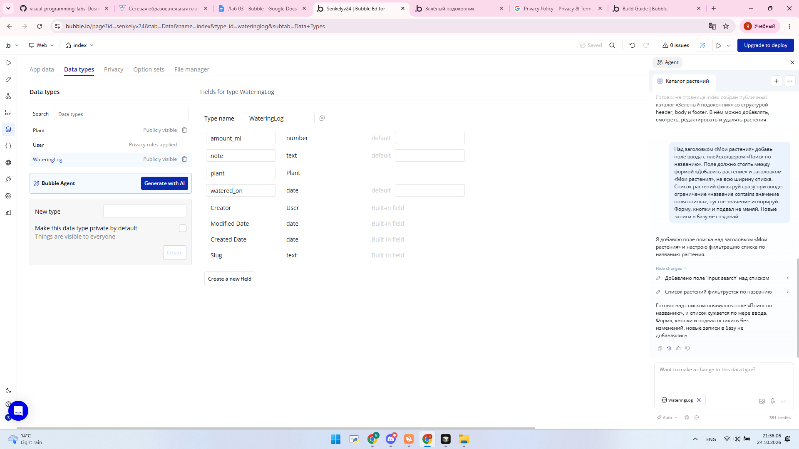

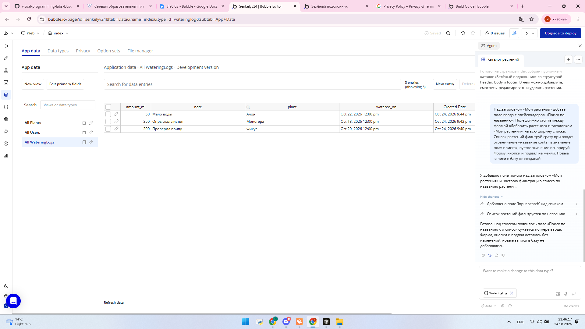

## 6. Страница полива и workflows

Промпт агенту на новую страницу:

```
Создай новую страницу watering для журнала полива. Интерфейс только для уже существующего типа WateringLog. На странице: заголовок «Журнал полива», выпадающий список растений (тип Plant, показывать поле name), поле даты полива, поле объёма в миллилитрах, поле заметки, кнопка «Добавить запись». Ниже список уже существующих записей WateringLog: растение, дата, объём, заметка, кнопки «Изменить» и «Удалить». Каждое действие — отдельный workflow: создание записи, показ списка, изменение записи, удаление записи. Страницу index не меняй. Поля типа WateringLog не меняй. Новые записи в базу не создавай и данные массово не генерируй.
```

Страницу `index` и поля `WateringLog` агент не менял. На `watering` шесть отдельных workflow. Для сдачи важны четыре.

- **Создание записи.** Кнопка «Добавить запись», только если состояние `watering's editing` пустое и выбраны растение и дата. Шаг Create a new WateringLog: `plant` из выпадающего списка, `watered_on` из даты, `amount_ml` из объёма, `note` из заметки. Затем Reset Form.
- **Показ списка.** Repeating group читает существующие `WateringLog` и показывает растение, дату, объём и заметку.
- **Изменение записи.** «Изменить» кладёт текущую строку в `watering's editing` и заполняет форму, кнопка становится «Сохранить». Сохранение делает Make changes to WateringLog у `watering's editing` теми же четырьмя полями, затем сбрасывает состояние и форму.
- **Удаление записи.** Delete WateringLog, удаляется `Parent group's WateringLog`. Если удаляли как раз открытую на редактирование строку, состояние сбрасывается.

В Preview проверил цикл на одной пробной записи: Фикус, 24.10.2026, 120 мл, заметка «Проверка формы». После сохранения заметка стала «Полил после проверки». Эту строку удалил. В базе снова три исходных полива.

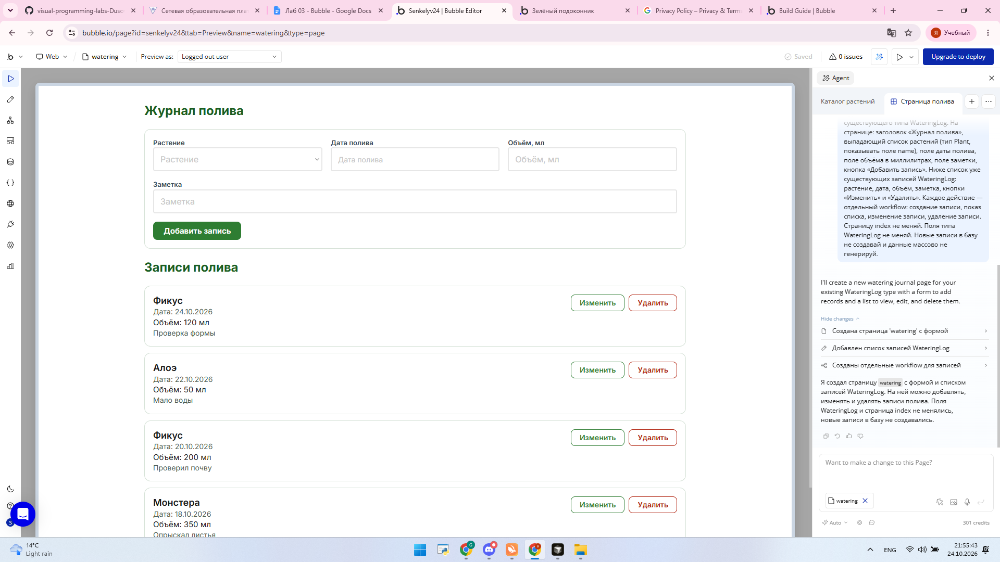

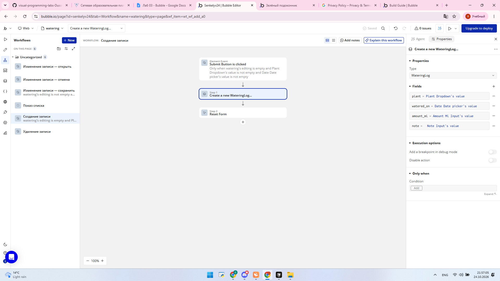

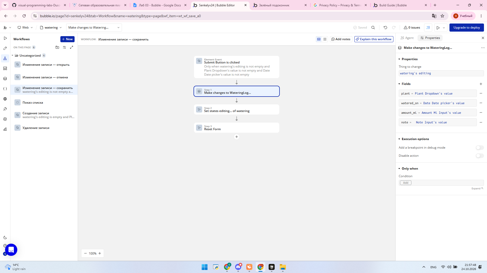

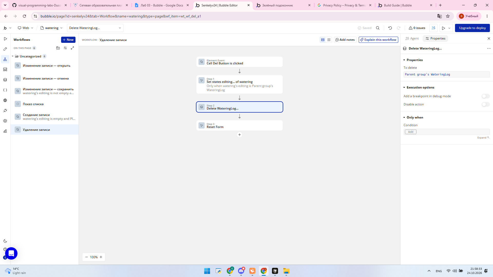

## 7. Что генерировал агент и что делал руками

Агент собрал каркас каталога, поле поиска и страницу `watering` с workflows. Руками менял шапку, переменную `primary-color`, стиль «Кнопка растения» и Alert. Тип `WateringLog` и три записи тоже вносил сам. Приватность по Current User не включал: приложение публичное.

## 8. Вывод

Bubble быстро даёт страницу с формой и списком, но агент не заменяет проверку. Поиск по задумке должен был искать вхождение, а в Preview отбирает только полное название. Журнал полива удобнее держать отдельным типом со ссылкой на растение: у одного растения несколько поливов, а карточка растения от этого не раздувается. На защите проще всего показать Preview страницы `watering` и четыре workflow: создание при пустом `editing`, правка этой же записи, удаление строки группы и сброс формы.
