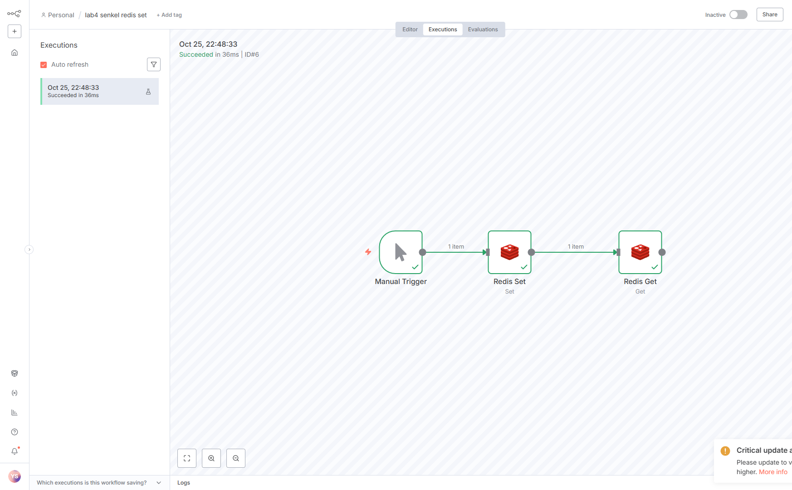
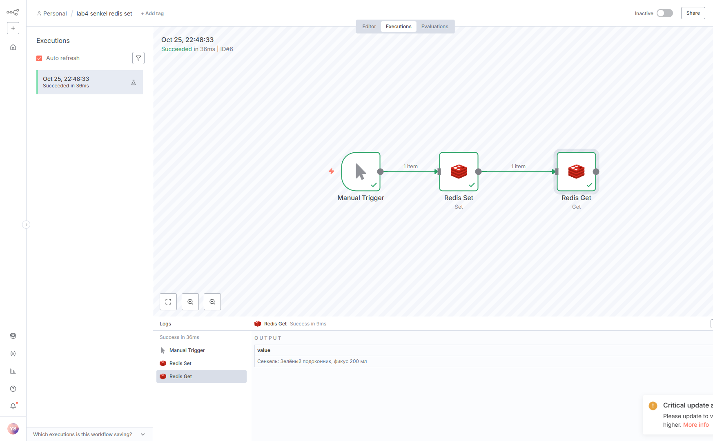
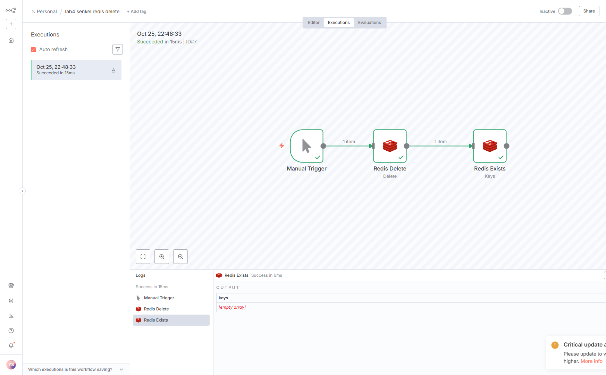

# Redis в лабораторной 4

Redis на этом компьютере запущен локально, не в Docker: процесс слушает `127.0.0.1:6379`, пароля нет, база 0. В `docker-compose.yml` контейнер называется `redis`, образ `redis:7`, порт `6379:6379`. Если n8n тоже в контейнере, хост в учётных данных должен быть `host.docker.internal`. У локального n8n хост `127.0.0.1`.

Учётные данные в редакторе: имя «Redis senkel», тип Redis.

У узла Redis версии 1.114.4 нет операции Exists. В списке есть delete, get, incr, info, keys, pop, publish, push, set. Проверку «ключа нет» делает узел с именем Redis Exists, но операция у него `keys`: шаблон `senkel`, значения не забирать. Пустой массив `keys` значит, что ключа уже нет.

Сначала запускается сценарий записи, потом сценарий удаления. Если сделать наоборот, читать будет нечего.

## Запись и чтение

Файл: `flows/flow-09-redis.json`.

Manual Trigger → Redis Set → Redis Get.

- ключ: `senkel`
- тип ключа: string
- значение: `Сенкель: Зелёный подоконник, фикус 200 мл`
- Get пишет ответ в свойство `value`

На выполнении Get вернул эту же строку.

## Удаление и отсутствие

Файл: `flows/flow-10-redis.json`.

Manual Trigger → Redis Delete → Redis Exists.

Delete удаляет ключ `senkel` и пропускает входной предмет дальше без нового поля. Следующий узел ищет ключи по шаблону `senkel`. Ответ: `keys` — пустой массив.

