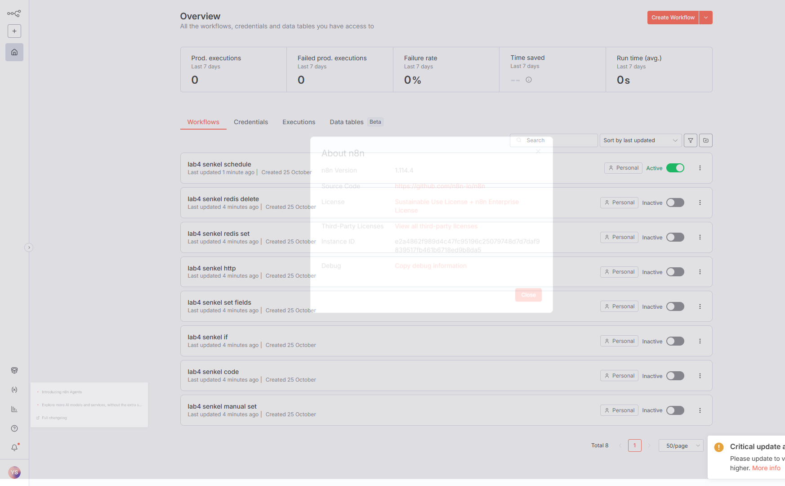
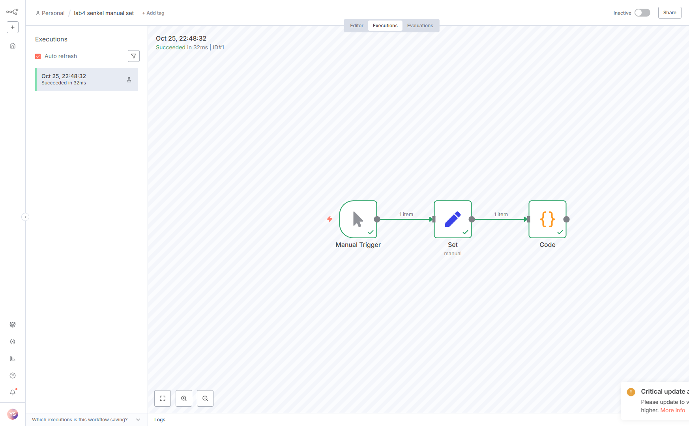
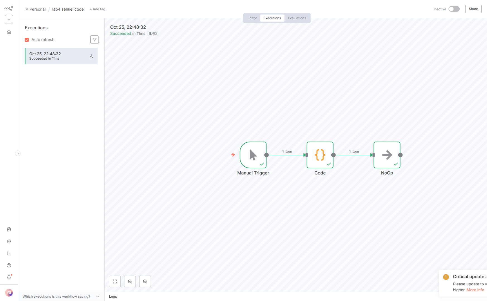
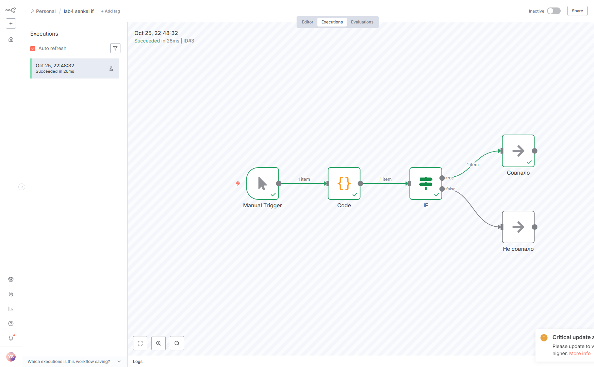
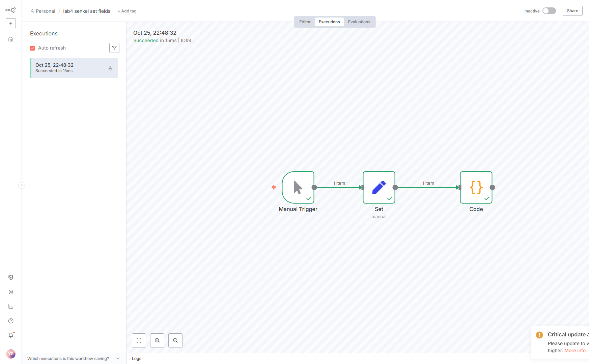
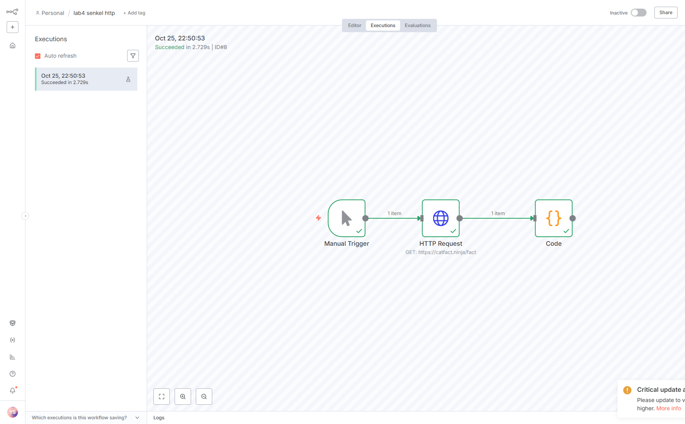
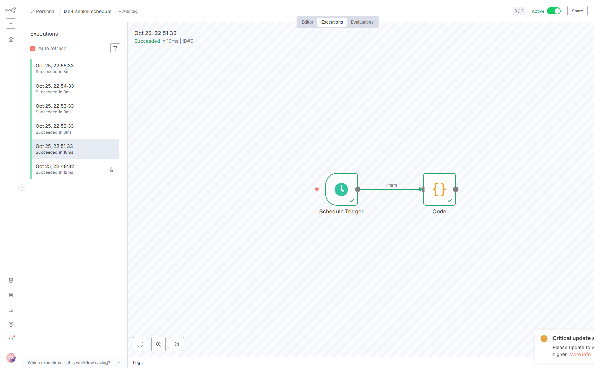

# Отчёт по лабораторной работе №4. n8n

**Студент:** Сенкель Ярослав Витальевич

Восемь сценариев в n8n 1.114.4. В названиях и данных стоит фамилия Senkel. Ачивку не брал: четвёртая часть условия необязательная, и для третьей лабораторной я её тоже не делал.

Редактор: http://localhost:5678

## 1. Запуск

В условии n8n и Redis поднимаются через Docker. На этом компьютере нет Docker и нет WSL, поэтому контейнеры я не запускал и скриншот `docker compose` не подделывал. Файл `docker-compose.yml` в папке `lab4` написан по условию: образ `n8nio/n8n:1.114.4`, порт 5678, том `./n8n-data` в `/home/node/.n8n`, том `./data` в `/data`, рядом контейнер `redis:7` на порту 6379. Когда Docker появится, запуск из папки `lab4`: `docker compose up -d`.

Сейчас n8n стоит локально (`npm install` в `lab4`, команда `npm start`). Redis — отдельный `redis-server` на `127.0.0.1:6379`. В compose для n8n внутри контейнера хост Redis был бы `host.docker.internal`. У локального n8n в учётных данных Redis стоит `127.0.0.1`.



## 2. Сценарии

### 2.1 Manual Trigger, Set, Code

Set кладёт `payload = Senkel` и `topic = lab4/senkel/basic`. Code возвращает эти поля и `student: Senkel`.

Файл: `flows/flow-01-manual-set.json`.



### 2.2 Code

Manual Trigger, Code, NoOp. В коде есть `let` и `const`, `if/else`, цикл `for`, массив и объект. Растения те же, что в третьей лабораторной: Алоэ, Монстера, Фикус. Фикус считается политым. На выходе объект `payload` со студентом Senkel, числом `watered` и заметками.

Файл: `flows/flow-02-code.json`.



### 2.3 IF

Code готовит `payload`. Если фикус полит, payload равен `Senkel`, иначе `empty`. IF сравнивает payload со строкой `Senkel`. Ветка true идёт в NoOp «Совпало», false — в «Не совпало». На запуске сработал true.

Файл: `flows/flow-03-if.json`.



### 2.4 Set с несколькими полями

Set задаёт `topic = lab4/senkel/set`, `timestamp` выражением `{{ $now.toISO() }}` и `payload = Senkel`. Code печатает весь входящий объект в поле `msg`. На запуске время было `2026-10-25T22:48:32.874+03:00`.

Файл: `flows/flow-04-set.json`.



### 2.5 HTTP Request

GET без токена на `https://catfact.ninja/fact`, ответ JSON. Code забирает `fact` и `length`. Пришёл факт: «Unlike humans, cats cannot detect sweetness which likely explains why they are not drawn to it at all.» Длина 102.

Файл: `flows/flow-05-http.json`.



### 2.6 Schedule

Schedule Trigger раз в 1 минуту: для показа условие это разрешает, ждать 5 минут на защите не нужно. Code возвращает текущее время и `student: Senkel`. Сценарий был включён, сам отработал несколько раз, на скриншоте переключатель Active. После снимка я его выключил, чтобы на этом компьютере он не крутился каждую минуту. В файле экспорта `active` поэтому `false`.

Файл: `flows/flow-06-schedule.json`.



## 3. Redis

Отдельно в `docs/redis.md`. Коротко: ключ `senkel`, значение «Сенкель: Зелёный подоконник, фикус 200 мл». Сначала запись и чтение, потом удаление и проверка, что ключа нет.

## 4. Ачивка

Не делал.

## 5. Промпты

Условие из файла лабораторной я отдал помощнику целиком. Отдельно написал, что ачивку делать не нужно. Дословный запрос на эту работу:

```
сделай 4 лабу по примеру C:\Users\Ya\Downloads\Копия Лаб 04 - n8n.docx
```

И раньше, ещё по третьей работе: «ачивки делать не надо». Номер группы в промпт не добавлял. Сценарии дальше собраны по пунктам 2.1–2.6 и части 3 этого условия, фамилия в данных — Senkel.

## 6. Какие узлы разобрал

Manual Trigger, Set, Code, NoOp, IF, HTTP Request, Schedule Trigger, Redis. Set подставляет поля до кода. Code считает на JavaScript. IF делит поток на true и false. HTTP Request ходит наружу без токена. Schedule запускает сценарий сам. Redis пишет и читает строку по ключу.

## 7. Вывод

n8n удобно смотреть как цепочку: каждый узел получает предмет от предыдущего и отдаёт свой. Фамилия в payload сразу видна в выполнении, по ней можно найти свой сценарий. Redis здесь не база приложения, а одна строка по ключу: записал, прочитал, стёр, убедился, что ключа нет. Без Docker лабораторная всё равно запускается, но файл compose в репозитории оставлен, как просит условие.
